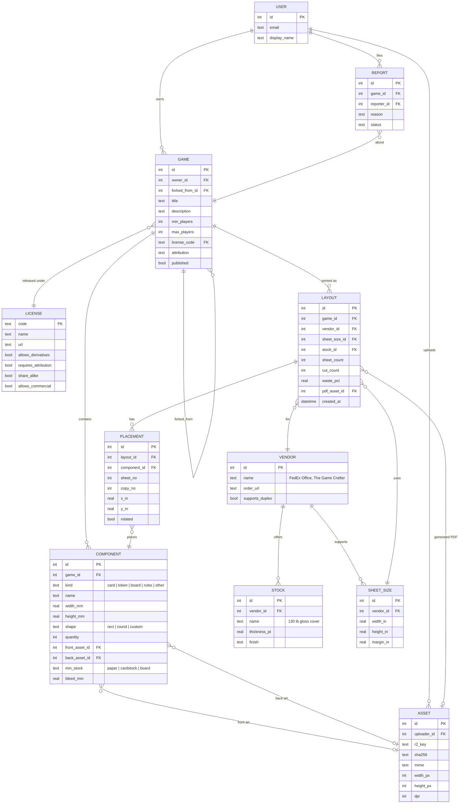
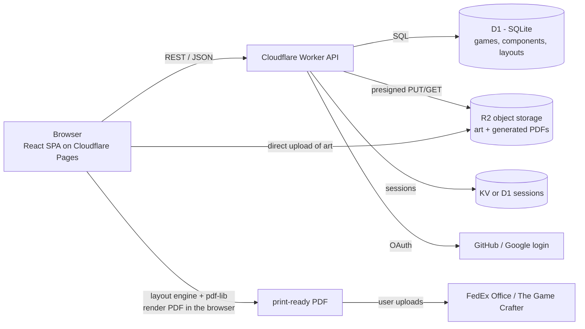

# Initial Design: PrintPlay Share

## Purpose and goals

People share 3D models so that anyone can print them. PrintPlay Share does the same for **board games people design
themselves**: you share the art and an exact description of every component, and anyone can turn it into a
**print-ready order**. It is **free and non-commercial**. Nobody buys or sells anything on the site; the point is to
share ideas. Printing is paid directly to whatever print shop the player chooses.

Goals:

1. **Describe a game as data.** List the components (cards, tokens, board, rules) with size, shape, quantity,
   front and back art, and the stock each needs.
2. **Generate an easy-to-cut layout.** Pack components onto a vendor's sheet size so that neighbors share cut lines,
   cuts run straight across the sheet, and trimming waste is low. Report waste % and the number of cuts.
3. **Make printing easy.** Produce a print-ready PDF with bleed, cut marks and mirrored backs, plus a plain-English
   order sheet for a specific vendor ("FedEx Office: 13x19, 130 lb gloss cover, double-sided, 4 sheets").
4. **Share and adapt, with licenses like 3D-model sites use.** The creator picks a license when publishing
   (see below). Adapting a game (new art, a different language, house rules) is allowed only if the license allows
   it. The adapted game keeps a link back to the original and shows its credit line automatically.
5. **Example:** a small bluffing game inspired by the mechanics of HOAX (Eon, 1981), remade with original art and
   wording.

Non-goals: payments or selling anything (it's a sharing site, not a store), sending orders automatically to FedEx's
Print API (stretch goal), 3D parts.

### Licensing (modeled on 3D-model sharing sites)

The creator chooses one license per game. The site enforces it in the UI and the data:

| License | Can others adapt it? | Must credit the creator? | Adaptations must share alike? | Commercial use |
|---------|-----------|----------------|--------------------------|----------------|
| CC0 (public domain) | yes | no | no | yes |
| CC BY | yes | yes | no | yes |
| CC BY-SA | yes | yes | yes | yes |
| CC BY-NC (default) | yes | yes | no | no |
| CC BY-NC-SA | yes | yes | yes | no |
| CC BY-ND / BY-NC-ND | **no** | yes | no | NC: no |
| Personal printing only | **no** | yes | no | no |

- The **Adapt** button is shown only when `allows_derivatives` is true. If the original is share-alike (SA), the
  adaptation is locked to the same license.
- Credit is built from the chain of `forked_from_id` links and printed on every generated PDF in a small footer
  ("'Game' by A, adapted by B, CC BY-NC-SA").
- Creators confirm they own the art they upload. A report and takedown flow handles mistakes.

```
Designer uploads art + component list
        │
        ▼
  [Game page] ──► choose vendor + stock ──► [Layout engine] ──► print-ready PDF + order sheet
        │                                                        │
        └──► adapt the game (fork) ◄──── others                  └──► FedEx Office upload / The Game Crafter
```

## Initial ERD



Notes:

- `GAME.forked_from_id` is a self-reference, so you can follow a chain of adaptations back to the original.
- `ASSET.sha256` deduplicates uploads. The same card back used in 50 games is stored once in R2.
- A layout is cached by (game version, vendor, sheet size, stock), so regenerating it is cheap.
- `PLACEMENT` rows are enough to rebuild the PDF, so the PDF itself can be thrown away and regenerated.

## System design (Cloudflare, cheap storage)



Why this stack:

- **R2** holds all the art. It has no egress fees, so downloading large art and PDFs doesn't cost per GB. Storage is
  cheap, and the free tier covers a class project.
- **D1** (SQLite at the edge) fits the relational model above and costs nothing at this scale.
- **Workers and Pages** cost nothing to host at this scale and run on the same platform as the data.
- **PDFs are generated in the browser** with pdf-lib, which avoids the Worker CPU-time limit. The layout engine is a
  shared TypeScript module, so the Worker can also compute layouts (waste %, number of cuts) for the game page.
- Uploads go **straight from the browser to R2** using presigned URLs, so large images never pass through the Worker.

The layout engine is guillotine 2D bin packing:

1. Group components by stock and size.
2. Put same-size items into grids (rows and columns) with no gaps, so neighbors share cut lines.
3. Fill the leftover strips using guillotine-split heuristics.
4. Score each layout by waste %, then number of cuts, then number of sheets.

Concerns to address later: concurrency (two users editing the same game: last-write-wins with a version
number), scaling (art is on R2, metadata is small), auth (OAuth plus owner checks on every write), and
copyright (license field, attribution, report and takedown flow).

## Rough UX

```
┌──────────────── Game: Bluff Council (example) ─────────────────────────┐
│ by mreynolds · CC BY-NC-SA · adapted from: —     [Adapt this game]     │
├────────────────────────────────────────────────────────────────────────┤
│ Components                      qty   size       stock                 │
│  Role cards                     12    2.5x3.5    cardstock             │
│  Resource tokens                60    0.75 sq    board                 │
│  Reference cards                12    2.5x3.5    cardstock             │
│  Rules                           1    letter     paper                 │
├────────────────────────────────────────────────────────────────────────┤
│ Print with: [FedEx Office ▾] [13x19 ▾] [130 lb gloss ▾]                │
│  → 3 sheets · 22 cuts · 6% waste       [Preview] [Download PDF]        │
│  Order sheet: 13x19, 130 lb gloss cover, duplex, 3 sheets, cut on marks│
└────────────────────────────────────────────────────────────────────────┘
```

## Initial daily goals (through end of class)

| Date | Goal |
|------|------|
| Mon 11/23 | Research, initial design, repo, log |
| Tue 11/24 to Sat 11/28 | Cloudflare setup (Pages + Worker + D1 + R2); D1 schema migration; seed vendors and stocks (FedEx Office, The Game Crafter) |
| Mon 11/30 | Layout engine v1: grid packing of same-size cards, cut count and waste %, unit tests |
| Tue 12/1 to Wed 12/2 | PDF generation in the browser (bleed, cut marks, mirrored backs); print a test sheet at FedEx |
| Thu 12/3 to Sat 12/5 | Upload art to R2; game and component editor; HOAX-inspired example game with original art |
| Mon 12/7 | Publish and browse games; license picker; adapt (fork) with automatic credit lines; OAuth login; layout cache |
| Tue 12/8 to Wed 12/9 | Mixed-size guillotine packing; order sheet; in-class presentation |
| Thu 12/10 | Final report, diagrams, demo GIF; log totals |
